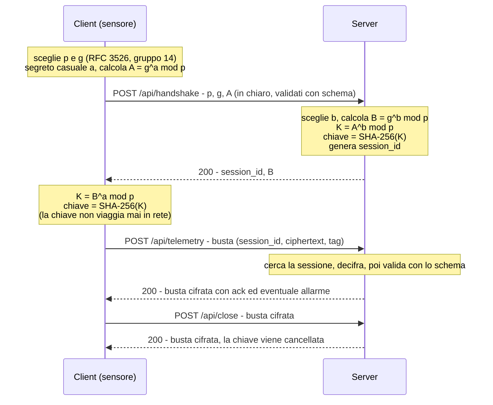

# FrigoTrack – Telemetria sicura per la catena del freddo

Prototipo client-server HTTP in cui i sensori di temperatura inviano misure JSON **cifrate** con una chiave concordata tramite **Diffie-Hellman** e **validate con JSON Schema**.
Il canale resta HTTP semplice: la cifratura è a carico dell'applicazione e la chiave non viaggia mai in rete.

Stack: C# / .NET 8, ASP.NET Core (minimal API), pacchetto NuGet `JsonSchema.Net`.

## Struttura del repository

```
Server/    Program.cs, Server.csproj, schemas/   server di raccolta dati
Client/    Program.cs, Client.csproj, schemas/   client che simula 3 sensori
RELAZIONE.md                                     scelte tecniche e limiti noti
```

La cartella `schemas/` contiene gli schemi JSON e viene copiata accanto all'eseguibile sia nel server sia nel client (vedi `.csproj`).

## Avvio

Requisiti: .NET 8 SDK. I pacchetti NuGet vengono ripristinati automaticamente.

```bash
# terminale 1: server su http://localhost:5000
cd Server
dotnet run

# terminale 2: client (3 sensori, 3 giri di misure ogni 2 secondi, poi i casi di test)
cd Client
dotnet run
```

Il server salva le misure in memoria e le accoda al file `readings.jsonl` (nella cartella di lavoro del server).

## Handshake Diffie-Hellman



Numeri grandi (`p`, `g`, `A`, `B`) sono scritti in **esadecimale**.

## Busta cifrata

Dopo l'handshake ogni messaggio viaggia in una busta:

```json
{
  "session_id": "a3f9c2e1",
  "ciphertext": "<Base64 di: nonce (12 byte) + dati cifrati>",
  "tag": "<Base64 del tag GCM, 16 byte>"
}
```

- Algoritmo: **AES-256-GCM**. Il nonce (12 byte casuali) è anteposto ai dati cifrati dentro `ciphertext`.
- Il JSON applicativo viene decifrato dal ricevente e poi validato con lo schema.
- In rete l'unico dato in chiaro è il `session_id`.

## Endpoint e messaggi

| Endpoint              | Corpo della richiesta                                                                           | Risposta 200                                                                                               |
| --------------------- | ----------------------------------------------------------------------------------------------- | ---------------------------------------------------------------------------------------------------------- |
| `POST /api/handshake` | `p`, `g`, `A` (esadecimale, in chiaro) – `schemas/handshake_request.json`                       | `session_id`, `B` (in chiaro)                                                                              |
| `POST /api/telemetry` | busta con la misura – `schemas/telemetry.json`                                                  | busta con `{"status":"ok","alarm":false}`; se la temperatura è fuori range anche `message` e `alarm: true` |
| `POST /api/readings`  | busta con `sensor_id` e, opzionali, `from` / `to` (date-time) – `schemas/readings_request.json` | busta con `{"count": n, "readings": [...]}` – `schemas/readings_response.json`                             |
| `POST /api/close`     | busta con un oggetto JSON qualsiasi                                                             | busta con `{"status":"closed"}`; la chiave di sessione viene cancellata                                    |

Esempio di misura (prima di essere cifrata):

```json
{
  "sensor_id": "CELLA-BG-007",
  "timestamp": "2026-11-02T08:15:30Z",
  "cargo_type": "pharma",
  "temperature_c": 4.6,
  "humidity": 55,
  "battery": 87
}
```

### Allarmi

Il server segnala `alarm: true` quando la temperatura esce dall'intervallo di sicurezza:

| Merce (`cargo_type`) | Intervallo °C |
| -------------------- | ------------- |
| `pharma`             | 2 … 8         |
| `food`               | 0 … 6         |
| `frozen`             | −25 … −15     |

### Codici HTTP ed errori

| Codice | Quando                                                                                                                             |
| ------ | ---------------------------------------------------------------------------------------------------------------------------------- |
| 200    | richiesta valida                                                                                                                   |
| 400    | JSON non valido; busta malformata, decifratura o tag falliti (nulla viene elaborato); messaggio decifrato non conforme allo schema |
| 401    | `session_id` mancante nella busta                                                                                                  |
| 404    | sessione inesistente (anche dopo `close`) o endpoint sconosciuto                                                                   |

- Se il messaggio **decifrato** non rispetta lo schema, il server risponde 400 con una busta **cifrata** contenente `{"error": "..."}` (`schemas/error.json`). Il testo dell'errore riporta il campo sbagliato (`instanceLocation`, ad esempio `/temperature_c`).
- Gli errori che avvengono prima di poter decifrare (busta manomessa, sessione inesistente, `session_id` mancante) sono in chiaro: `{"error": "..."}` con un testo generico, senza dati.

## Schemi JSON (`schemas/`, draft 2020-12)

| File                     | Messaggio                                          |
| ------------------------ | -------------------------------------------------- |
| `handshake_request.json` | richiesta di handshake (`p`, `g`, `A` esadecimali) |
| `telemetry.json`         | misura del sensore                                 |
| `readings_request.json`  | richiesta dell'elenco misure                       |
| `readings_response.json` | risposta con l'elenco misure                       |
| `error.json`             | messaggio di errore                                |

Vincoli usati: `type`, `required`, `enum`, `minimum` / `maximum`, `pattern`, `format` (`date-time`), `additionalProperties: false`.

## Cosa fa il client

1. Valida la richiesta di handshake con lo schema, esegue l'handshake e ricava la chiave **prima** di inviare qualsiasi dato.
2. Simula 3 sensori (`CELLA-BG-001` pharma, `CAMION-MI-002` food, `CELLA-BS-003` frozen) che inviano una misura ciascuno per 3 giri, a intervalli di 2 secondi.
3. **Valida ogni messaggio con lo schema prima di cifrarlo**; se non è valido non lo invia.
4. Decifra le risposte e le valida (`readings_response.json`, `error.json`).
